

Write **LSL** (Linden Scripting Language) and **SLua** (Second Life Lua) directly inside IntelliJ IDEA, PyCharm, Android Studio, and other JetBrains
editors across Windows, macOS, and Linux.

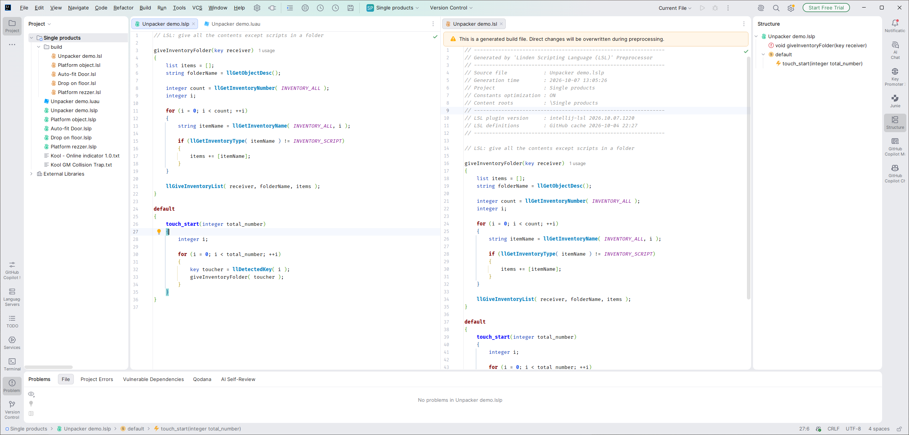

### Key Features

* **Project & File Organization:** Manage large multi-file projects using structured project views, shared library, local history, file comparison, GitHub integration, AI chat, and more.
* **Up-to-date language definitions:** LSL functions, constants, and events, along with SLua definitions and documentation, are downloaded from the official [Second Life language definitions](https://github.com/secondlife/lsl-definitions) project. The plugin checks for updates or can use a custom local folder instead.
* **Smart Scripting Tools:** Instant syntax highlighting, real-time error checking, smart auto-completion, and safe variable/function refactoring.
* **Code Formatting & Clean Up:** Automatically format your code, fix indentation, and keep your scripts clean and readable.
* **Advanced Preprocessor (LSL only):** Use file inclusions (`#include`), function inlining (`#inline`), and conditional blocks (`#ifdef`...) to organize large script projects. SLua uses the `require()` module system instead.
* **Memory Optimization (LSL only):** Before compiling, built-in constant optimization evaluates static math, replaces fixed variables, and eliminates dead code to help keep scripts within LSL's memory limits. SLua has its own methods.
* **Push scripts to in-world objects:** Explore in-world objects and push scripts to selected objects through viewer's WebSocket. Your local project remains the master source, so your scripts are preserved even if the in-world objects are deleted. _(Requires Second Life 26.4+. Firestorm coming soon.)_

### Auto-completion
- **LSL**

  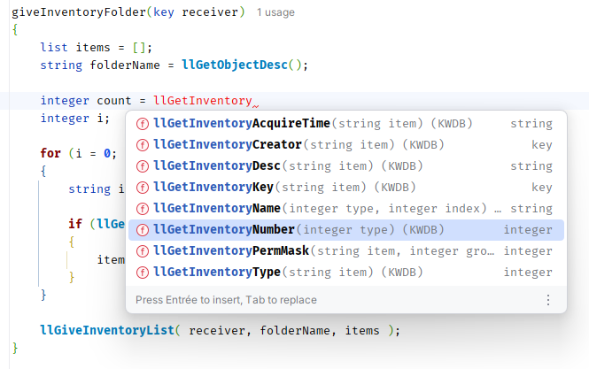

- **SLua**

  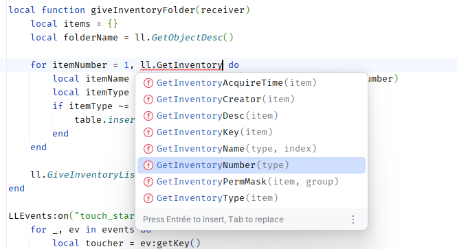

---

### Inspections & Errors
- **LSL**

  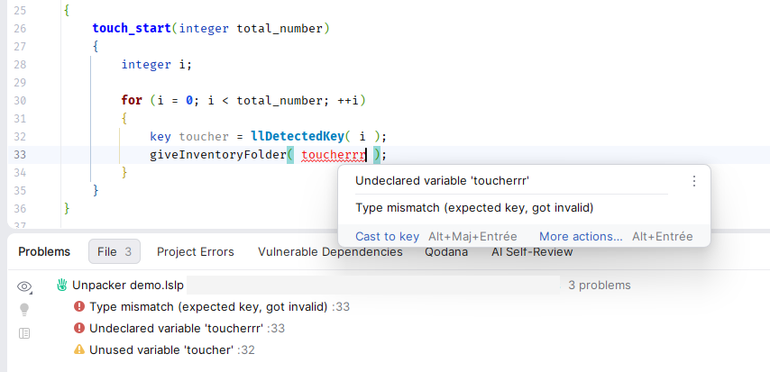

- **SLua**

  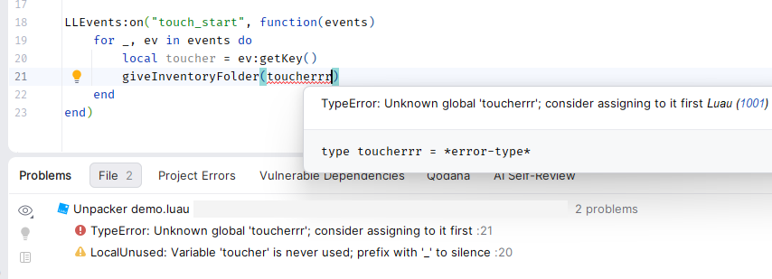

---

### Quick Documentation Popup
- **LSL**

  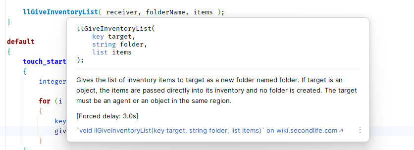

- **SLua**

  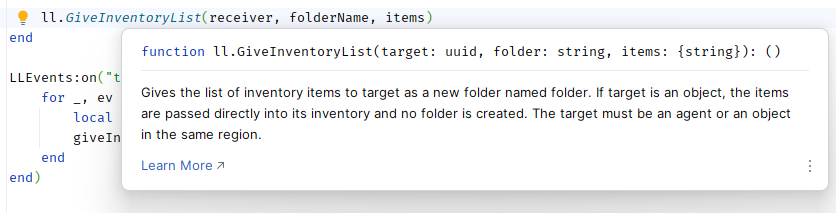

---
### Smart Refactor
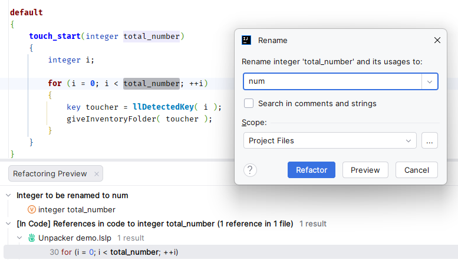

---

### IntelliJ vs VS Code

VS Code with the [official Second Life extension](https://github.com/secondlife/sl-vscode-plugin) is great for quickly editing live scripts directly in-world. IntelliJ IDEA with the KoolLSL plugin focuses on larger, long-term offline development workflows: organize scripts and libraries in a structured project, then manually push them to their corresponding in-world objects.

---
### How to Install

1. Open your JetBrains IDE such as [IntelliJ IDEA](https://www.jetbrains.com/idea/).  
 
2. Install the plugin using your preferred method:
    * 
    * **From Marketplace**: Settings > Plugins > Marketplace, search for **intellij-lsl** (or "LSL & SLua for Second Life" by Kool) > **Install**.
    * **From GitHub:**: Settings > Plugins, click the ⚙️ icon at top > **Install Plugin from Disk...** to use a
      downloaded `intellij-lsl-version.zip` from [GitHub Releases](https://github.com/KoolLSL/intellij-lsl/releases).  

3. Go in Settings > Languages &amp; Frameworks > <b>LSL</b>.
    * **LSL**  language: The KoolLSL plugin works out of the box with no extra setup.
    * **SLua** language: The KoolLSL plugin needs the companion [Luau plugin](https://plugins.jetbrains.com/plugin/24957) and provides it with  additional Second Life's SLua definitions. Click the link to install it if needed. It will install other required components, including `luau-lslp` from Johnny Morganz (the same Luau engine used by the VS Code extension). 
    * The Settings > **Plugins** page should show this (LSP4IJ is only for IntelliJ Free edition): 
         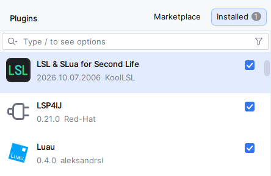
     

4. Go in Settings > Languages &amp; Frameworks > **Luau**, verify language setup:
    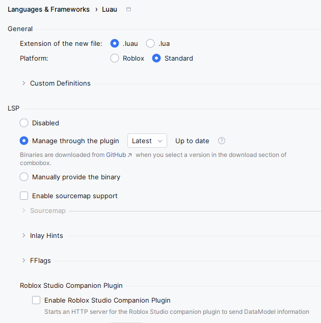
       

4. From Settings > Languages &amp; Frameworks > **LSL**, copy <code>--definitions</code> and <code>--docs</code> full paths. They indicate where the definitions were downloaded from GitHub:
    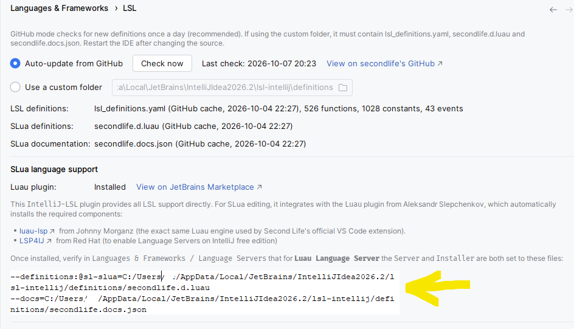
     

5. Paste in Settings > Languages &amp; Frameworks > Language Servers > 
    **Luau Language Server**, for both <b>Server</b> and <b>Installer</b>, the same
 <code>--definitions</code> (including the <code>:@sl-slua</code> token) and <code>--docs</code> paths indicated on the <b>LSL</b> page: 
   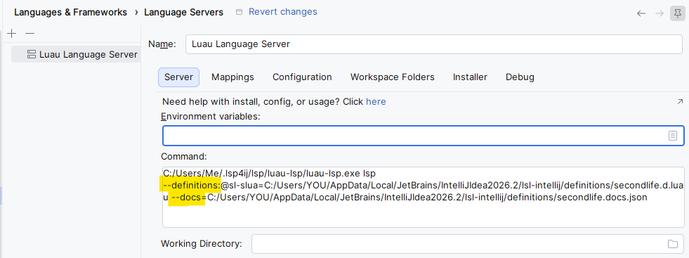
   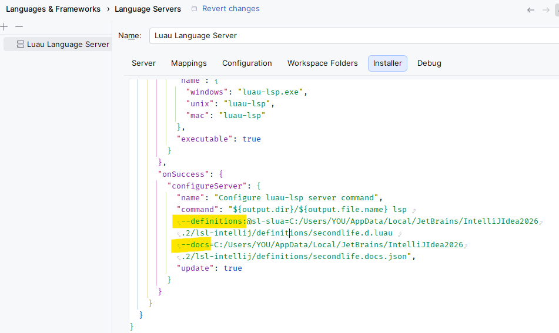
     

6. Type **LSL** in your IDE **Settings** to customize other plugin options: Code Style, Color Scheme, Inspections, Inlay Hints...  

---

### How to Use

1. **Create a Project:** Open your IDE, go to **File → New → Project...** and create an empty project, or use **File →
   New → Project from existing sources...**.
2. **Choose your language:**
   * **LSL:** Select **File → New → LSL Source Script...** to create a `.lslp` source file (for example,
     `MyScript.lslp`). Save it (`Ctrl+S`) to build it; the plugin generates an optimized, read-only `.lsl` file in the
     `/build` folder (for example, `/build/MyScript.lsl`). Right-click the `.lslp` editor tab and select
     **Open Generated .lsl** to view the output.
   * **SLua:** Select **File → New → Luau File** to create a `.luau` script. There is no separate build step: the `.luau` file is the script you use.
3. **Use your script in Second Life:** Choose the workflow that suits you:
   * **Viewer push:** Push project scripts to an in-world explored object, as described below.
   * **Firestorm:** Use the LSL preprocessor to `#include` your built `.lsl` file (for example, `#include "MyProject/build/MyScript.lsl"`).
   * **Copy and paste:** Copy the script contents into the in-world editor.

### Push scripts to an in-world object

Viewer push connects IntelliJ to your Second Life Viewer. To get started, enable it under Settings > Languages &amp; Frameworks >  **LSL**, then, in SL viewer, start **Build → Scripts → Script Editor Server**. Open the object's **Content** tab and click **Explore in IDE**. In IntelliJ, click the **Viewer** widget in the bottom status bar, or choose **Tools → Second Life**, to open the selector.

Select an object to push its matching scripts, or select individual scripts, then click **Push**. IntelliJ matches scripts by name (without the extension)—for example, `build/Script A.lsl` matches the in-world script `Script A`, and `Script B.luau` matches `Script B`. Matches are searched throughout your project, so unique script names are recommended. IntelliJ only updates scripts that already exist in the object; create a blank script in the viewer first if needed.

---

### Include Files (LSL only)

For LSL, you can split your code into reusable files and include them in your scripts as your project grows.

* **Create an include file (`.lslm`):** Use **File → New → LSL Module Script...** to create a shared file for functions
  or constants (for example, `MyLib.lslm`).
* **Include it in a script:** Add `#include "MyLib.lslm"` to an `.lslp` script. *(External folders must be added as
  Content Roots in Project Structure.)*
### Directives

* **`#define`** — Defines a constant or macro (e.g., `#define MODEL "PRO"`).
* **`#undef`** — Removes an existing definition (e.g., `#undef DEBUG`).
* **`#if`** — Evaluates a custom boolean expression (e.g., ``#if MODEL == "PRO"``).
* **`#ifdef`** — Includes code if an identifier is defined (e.g., `#ifdef DEBUG`).
* **`#ifndef`** — Includes code if an identifier is *not* defined (e.g., `#ifndef DEBUG`).
* **`#elif`** — Alternative conditional branch (`else if`) within a block.
* **`#else`** — Fallback branch when prior conditions fail.
* **`#endif`** — Closes an active conditional block.
* **`#include`** — Includes an external `.lslm` file (e.g., `#include "Vectors.lslm"`). The file must be in the same
  folder or in a folder of the Project properties / Content roots.
* **`#inline`** — Inlines the function written below directly in the code instead of calling it.
---

### Building the plugin (optional)

This project is open source, ready to use out of the box, and you do not need to build it for normal usage. The plugin is already available via the
JetBrains Marketplace and GitHub Releases, so building it locally is mainly for contributors who want to modify the source, or test a custom build.

1. **Open Project:** Open the repository root folder in IntelliJ IDEA (2026.2.1+).
2. **Test / Install:** In the Gradle tool window, run `Tasks -> intellij -> runIde` to launch a sandbox IDE, or
   `installPluginToIDE` to test directly in your main editor.
3. **Package:** Run `Tasks -> build -> buildPlugin` to generate the distribution `.zip` in `build/distributions/`.

---
### Issues & Feedback

> This plugin is a personal side project and may not be 100% perfect. If you run into obvious issues, please report them
> on [GitHub Issues](https://github.com/KoolLSL/intellij-lsl/issues).

This project is a modernized fork of the original [riej/lsl](https://github.com/riej/lsl) plugin. Compiled and tested on
**IntelliJ IDEA 2026.2.1**, **Java 17**, and **Windows 11**.

Compared to Eclipse/LSLForge, this plugin has no internal simulator but offers preprocessing and syntax checking inside
the more modern JetBrains IDEs. This also makes the plugin easier to install and maintain.

Second Life® and SL™ are registered trademarks of Linden Research, Inc. This plugin is an independent third-party tool and is not affiliated with, sponsored by, or endorsed by Linden Research, Inc.

